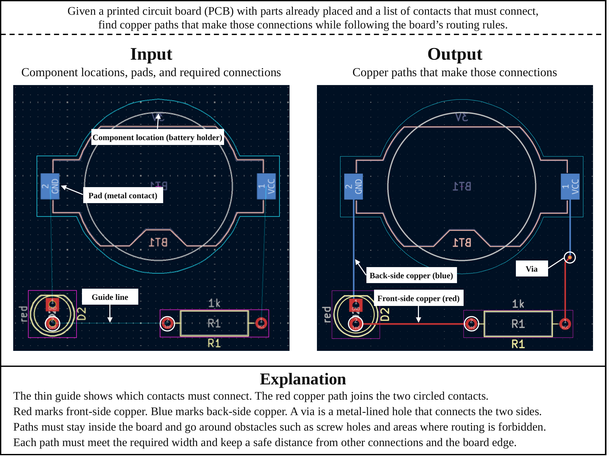
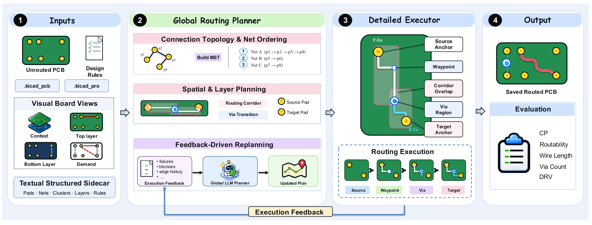

# PCBRouteAgent: How Close Are LLM Agents to Becoming PCB Routing Engineers?

<div class="research-tldr"><span class="eyebrow">TL;DR</span><p>PCB routing needs both a board-level strategy and precise geometric execution. PCBRouteAgent connects the two: it builds routing guides, executes them with KiCad, and revises the guides when local recovery is not enough. Across 247 boards, it achieves clean-pass rates of <strong>100%, 94.9%, 100%, and 40%</strong> on four PCBWorld-Bench splits. With the same Haiku backbone, it improves over PCBWorld's interactive agent on every split.</p></div>

## What does it mean to route a PCB?

A printed circuit board connects electronic components through copper traces. After the components have been placed, routing turns their intended electrical connections into physical paths across the board's copper layers. The router must connect the required pads while respecting constraints such as clearance, trace width, and allowed layer transitions.

The input to our task is a KiCad board with fixed component placement, a netlist, and design rules, with the target routes removed. The output is a routed board in the same native format. We judge success using the official PCBWorld evaluator: all required connections must be complete, and KiCad must report zero error-level design-rule violations. A plausible-looking trace is not enough.

<figure class="article-figure"><a class="figure-link" href="/assets/research/pcbrouteagent/task.png" aria-label="View full size"></a><figcaption><span>PCB routing connects required pads with copper traces and vias while satisfying design rules.</span><a href="/assets/research/pcbrouteagent/task.png">View full size ↗</a></figcaption></figure>

## Why separate planning from execution?

Each routing decision changes what remains possible. A short connection can block a corridor needed by another net; a locally successful path can make a later connection much harder. Choosing the next tool action without maintaining a broader routing plan can therefore lead to repeated failures and expensive interaction.

Our starting point is the way engineers coordinate board-level strategy with local routing decisions. Decide which regions and connections need to be linked, work out the detailed geometry with a routing engine, and reconsider the strategy when execution reveals an obstacle. This motivates an agent that reasons over routing guides rather than issuing every geometric routing action through the language model.

## Plan globally, route locally, revise with feedback

PCBRouteAgent has three functional components. An execution controller manages routing tasks, checkpoints, and bounded recovery.

1. **Global Routing Planner.** Given structured board information and board images, the planner specifies connections between disconnected clusters, routing order, soft corridors, and layer transitions. The initial guide is constructed by scripts; multimodal model planning is used to revise it when execution gets stuck.
2. **Detailed Routing Executor.** The executor realizes the guide using KiCad's native push-and-shove router. It handles geometric routing and bounded local recovery while preserving accepted connections.
3. **Feedback-Driven Replanning.** When local recovery cannot resolve a connection, the framework collects execution evidence and unresolved targets. The same global planner then revises the relevant guide, and execution resumes from a consistent board state.

The distinction matters: the language model does not need to micromanage every routing step. The native engine handles geometry, while the model revisits decisions that require a broader view of the board.

<figure class="article-figure"><a class="figure-link" href="/assets/research/pcbrouteagent/framework.png?v=3c60615" aria-label="View full size"></a><figcaption><span>Overview of PCBRouteAgent.</span><a href="/assets/research/pcbrouteagent/framework.png?v=3c60615">View full size ↗</a></figcaption></figure>

## Does the framework complete more boards?

We evaluate on **247 boards** from PCBWorld-Bench: 128 synthetic D2 boards, 99 small real-world D3-A boards, 10 medium D3-B boards, and 10 large D3-C boards. The main outcome below is **clean pass**: the fraction of boards with complete required connectivity and no error-level design-rule violations.

| Test split | Boards | Best evaluated baseline | Baseline clean pass | PCBRouteAgent · Opus |
| :--- | ---: | :--- | ---: | ---: |
| D2 | 128 | Freerouting / KiCadRoutingTools / PPO w/o finish | 100% | **100%** |
| D3-A | 99 | PCBWorld PPO w/o finish | 81.0% | **94.9%** |
| D3-B | 10 | Freerouting | 64.0% | **100%** |
| D3-C | 10 | Freerouting | 30.0% | **40.0%** |

On the three real-world splits, the Opus variant improves clean pass over the best evaluated baseline by **13.9, 36, and 10 percentage points**. On D2, it matches the full completion achieved by the strongest baselines.

<details class="evaluation-note"><summary>Evaluation details and the meaning of “baseline”</summary><p>D2, D3-A, and D3-B published baseline values follow PCBWorld Table 22 (@1); the Haiku interactive baseline and all D3-C results are evaluated locally. D3-B PCBRouteAgent results include retries of unscored model-response failures and angle repair. “Best evaluated baseline” excludes Reference, which scores the retained original routed designs rather than running an automatic router. Published baseline means can reflect a different aggregation from our single scored board per instance.</p></details>

## Is the gain just a stronger model?

We also compare PCBRouteAgent and PCBWorld's interactive agent using the **same Claude Haiku 5.5 backbone**. This tests whether the overall agent framework helps when model choice is held fixed.

<div class="comparison-key"><span><i class="baseline-key"></i>PCBWorld · Haiku</span><span><i class="ours-key"></i>PCBRouteAgent · Haiku</span><span>Clean pass · higher is better</span></div>
<div class="comparison-chart" role="img" aria-label="Haiku clean-pass comparison. D2: PCBWorld 63.3%, PCBRouteAgent 100%. D3-A: 34.3% versus 92.9%. D3-B: 0% versus 80%. D3-C: 0% versus 10%.">
<div class="comparison-row"><strong>D2</strong><div class="bar-pair"><div class="result-bar baseline-bar" style="--value:63.3%"><span>63.3%</span></div><div class="result-bar ours-bar" style="--value:100%"><span>100%</span></div></div><b>+36.7 pp</b></div>
<div class="comparison-row"><strong>D3-A</strong><div class="bar-pair"><div class="result-bar baseline-bar" style="--value:34.3%"><span>34.3%</span></div><div class="result-bar ours-bar" style="--value:92.9%"><span>92.9%</span></div></div><b>+58.6 pp</b></div>
<div class="comparison-row"><strong>D3-B</strong><div class="bar-pair"><div class="result-bar baseline-bar" style="--value:0%"><span>0%</span></div><div class="result-bar ours-bar" style="--value:80%"><span>80%</span></div></div><b>+80 pp</b></div>
<div class="comparison-row"><strong>D3-C</strong><div class="bar-pair"><div class="result-bar baseline-bar" style="--value:0%"><span>0%</span></div><div class="result-bar ours-bar" style="--value:10%"><span>10%</span></div></div><b>+10 pp</b></div>
</div>

The improvement holds across all four splits. It supports the effectiveness of the overall planning–execution framework beyond the choice of model backbone, although this comparison does not isolate the contribution of each component or equalize interaction budgets.

We do not conduct a full PCBWorld–Opus evaluation because we verified that its per-step model invocation incurs substantially higher API costs than PCBRouteAgent. The shared-Haiku comparison provides evidence without relying on an unmeasured Opus baseline.

## A closer look at routing decisions

Aggregate scores tell us whether a board passes. A case study should also show why a connection failed, what the planner changed, and whether that change helped. We have reserved the following space for board images and execution traces; no qualitative examples are reported here yet.

<div class="case-reserve"><div class="case-stage"><span class="slot-index">A / INITIAL STATE</span><div class="case-image-space">Board image to follow</div><h3>Where routing gets stuck</h3><p>Board context, unresolved connections, and the initial guide.</p></div><div class="case-stage"><span class="slot-index">B / REPLANNING</span><div class="case-image-space">Guide comparison to follow</div><h3>What changes in the guide</h3><p>Execution feedback and the resulting corridor or layer revision.</p></div><div class="case-stage"><span class="slot-index">C / FINAL STATE</span><div class="case-image-space">Routed board to follow</div><h3>What the evaluator finds</h3><p>Final connectivity, rule checks, and any remaining failure.</p></div></div>

## How close are we to a routing engineer?

There is still a substantial gap. On the largest split, the Opus variant passes four of ten boards. Its mean routability reaches 0.949, but high average connectivity does not guarantee that every connection on a board is complete and clean. Routing compactness also remains a challenge: on D3-C, wirelength is 8.2% higher than Freerouting, while clean pass improves from 30% to 40%.

These results point toward a useful division of work: let a native router handle physical execution, and use model reasoning to revise board-level decisions when execution provides evidence that they should change. Better completion on large boards, more compact routes, and controlled component ablations are the next questions to investigate.

## Citation

If you refer to this work, please cite the manuscript below. Publication details will be updated when available.

```bibtex
@unpublished{zhang2026pcbrouteagent,
  title  = {{PCBRouteAgent}: How Close Are {LLM} Agents to Becoming {PCB} Routing Engineers?},
  author = {Zhang, Yue and Sun, Jilei and Jing, Liqiang and Wei, Yijie and Yang, Ruohan},
  year   = {2026},
  note   = {Manuscript in preparation}
}
```

[Download BibTeX](/assets/research/pcbrouteagent/pcbrouteagent.bib)

## Resources

- [PCBRouteAgent code](https://github.com/chip-ai-agent/PCBRouteAgent)
- [PCBWorld: A Benchmark Environment for Engine-Grounded PCB Design Automation](https://arxiv.org/abs/2607.05915)
- [KiCad documentation](https://docs.kicad.org/)

This research note summarizes our current manuscript. Qualitative case studies will be added as they become available.
