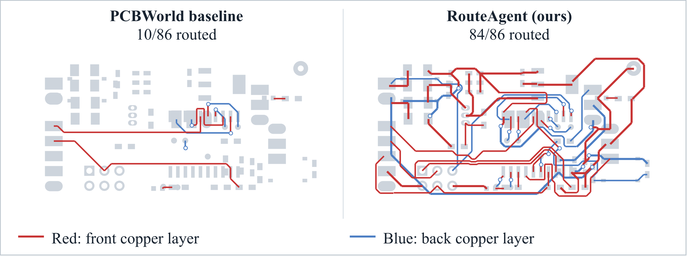
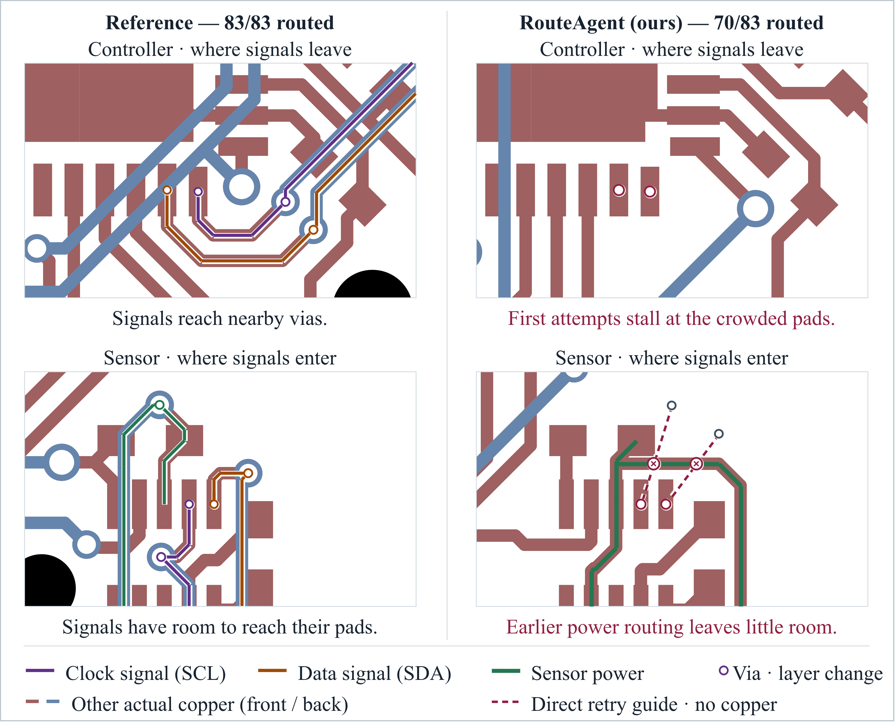
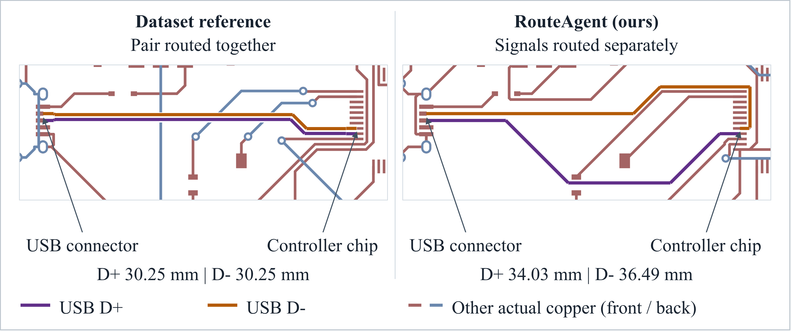

# PCBRouteAgent: How Close Are LLM Agents to Becoming PCB Routing Engineers?

<div class="research-tldr"><span class="eyebrow">TL;DR</span><p>PCBRouteAgent coordinates global planning with KiCad’s native router and revises guides from execution feedback. Across 247 boards, the Opus variant achieves <strong>100%, 94.9%, 100%, and 40%</strong> clean pass on D2, D3-A, D3-B, and D3-C. With the same Haiku backbone, it improves completion while using approximately <strong>131× fewer model calls and 4.3× lower API cost</strong> overall. Case studies also reveal a substantial engineering gap: early routes can block later connections, and complete connectivity can still overlook signal-specific constraints.</p></div>

## What does it mean to route a PCB?

A printed circuit board connects electronic components through copper traces. After the components have been placed, routing turns their intended electrical connections into physical paths across the board's copper layers. The router must connect the required pads while respecting constraints such as clearance, trace width, and allowed layer transitions.

The input to our task is a KiCad board with fixed component placement, a netlist, and design rules, with the target routes removed. The output is a routed board in the same native format. We judge success using the official PCBWorld evaluator: all required connections must be complete, and KiCad must report zero error-level design-rule violations. A plausible-looking trace is not enough.

<figure class="article-figure"><a class="figure-link" href="/assets/research/pcbrouteagent/task.png" aria-label="View full size"></a><figcaption><span>PCB routing connects required pads with copper traces and vias while satisfying design rules.</span><a href="/assets/research/pcbrouteagent/task.png">View full size ↗</a></figcaption></figure>

## Why separate planning from execution?

Each routing decision changes what remains possible. A short connection can block a corridor needed by another net; a locally successful path can make a later connection much harder. Choosing the next tool action without maintaining a broader routing plan can therefore lead to repeated failures and expensive interaction.

Our starting point is the way engineers coordinate board-level strategy with local routing decisions. Decide which regions and connections need to be linked, work out the detailed geometry with a routing engine, and reconsider the strategy when execution reveals an obstacle. This motivates an agent that reasons over routing guides rather than issuing every geometric routing action through the language model.

## Plan globally, route locally, revise with feedback

PCBRouteAgent has three functional components. An execution controller manages routing tasks, checkpoints, and bounded recovery.

1. **Global Routing Planner.** Given structured board information and board images, the planner specifies connections between disconnected clusters, routing order, soft corridors, and layer transitions. The initial guide is constructed by scripts; multimodal model planning is used to revise it when execution gets stuck.
2. **Detailed Routing Executor.** The executor realizes the guide using KiCad's native push-and-shove router. It handles geometric routing and bounded local recovery while preserving accepted connections.
3. **Feedback-Driven Replanning.** When local recovery cannot resolve a connection, the framework collects execution evidence and unresolved targets. The same global planner then revises the relevant guide, and execution resumes from a consistent board state.

The distinction matters: the language model does not need to micromanage every routing step. The native engine handles geometry, while the model revisits decisions that require a broader view of the board.

<figure class="article-figure"><a class="figure-link" href="/assets/research/pcbrouteagent/framework.png?v=6c9a9b8" aria-label="View full size"></a><figcaption><span>Overview of PCBRouteAgent.</span><a href="/assets/research/pcbrouteagent/framework.png?v=6c9a9b8">View full size ↗</a></figcaption></figure>

## Does the framework complete more boards?

We evaluate on **247 boards** from PCBWorld-Bench: 128 synthetic D2 boards, 99 small real-world D3-A boards, 10 medium D3-B boards, and 10 large D3-C boards. The main outcome below is **clean pass**: the fraction of boards with complete required connectivity and no error-level design-rule violations.

| Test split | Boards | Best evaluated baseline | Baseline clean pass | PCBRouteAgent · Opus |
| :--- | ---: | :--- | ---: | ---: |
| D2 | 128 | Freerouting / KiCadRoutingTools / PPO w/o finish | 100% | **100%** |
| D3-A | 99 | PCBWorld PPO w/o finish | 81.0% | **94.9%** |
| D3-B | 10 | Freerouting | 64.0% | **100%** |
| D3-C | 10 | Freerouting | 30.0% | **40.0%** |

On the three real-world splits, the Opus variant improves clean pass over the best evaluated baseline by **13.9, 36, and 10 percentage points**. On D2, it matches the full completion achieved by the strongest baselines.

<details class="evaluation-note"><summary>Evaluation details and the meaning of “baseline”</summary><p>D2, D3-A, and D3-B published baseline values follow <a href="https://arxiv.org/html/2607.05915v4#A12.T22">PCBWorld Table 22 (@1)</a>; the Haiku interactive baseline and all D3-C results are evaluated locally. D3-B PCBRouteAgent results include retries of unscored model-response failures and angle repair. “Best evaluated baseline” excludes Reference, which scores the retained original routed designs rather than running an automatic router. Published baseline means can reflect a different aggregation from our single scored board per instance.</p></details>

## What changes beyond clean pass?

Clean pass measures complete success at the board level. To see how routes differ, we also compare **routability** (the fraction of required connections completed), mean **DRV** count, wirelength, and via count. The interactive comparison below uses Claude Opus 5.5 for PCBRouteAgent and includes three rule-based routers: Freerouting, OrthoRoute, and KiCadRoutingTools. Select a test split and metric to inspect the results. Freerouting is the strongest evaluated rule-based baseline in clean pass on the real-world splits.

<!-- ROUTING_COMPARISON -->

<p class="chart-source">Source: rule-based results for D2, D3-A, and D3-B are from <a href="https://arxiv.org/html/2607.05915v4#A12.T22">PCBWorld Table 22 (@1)</a>. D3-C and PCBRouteAgent results are local evaluations.</p>

<details class="routing-details"><summary>Detailed Freerouting comparison</summary>
<table>
<thead>
<tr>
<th style="text-align: left;">Split</th>
<th style="text-align: left;">Method</th>
<th style="text-align: right;">Rout. ↑</th>
<th style="text-align: right;">DRV ↓</th>
<th style="text-align: right;">Wirelength (mm) ↓</th>
<th style="text-align: right;">Vias ↓</th>
</tr>
</thead>
<tbody>
<tr>
<td style="text-align: left;">D2</td>
<td style="text-align: left;">Freerouting</td>
<td style="text-align: right;"><strong>1.000</strong></td>
<td style="text-align: right;"><strong>0.00</strong></td>
<td style="text-align: right;">409.8</td>
<td style="text-align: right;">2.48</td>
</tr>
<tr>
<td style="text-align: left;">D2</td>
<td style="text-align: left;">PCBRouteAgent · Opus</td>
<td style="text-align: right;"><strong>1.000</strong></td>
<td style="text-align: right;"><strong>0.00</strong></td>
<td style="text-align: right;"><strong>392.5</strong></td>
<td style="text-align: right;"><strong>1.99</strong></td>
</tr>
<tr>
<td style="text-align: left;">D3-A</td>
<td style="text-align: left;">Freerouting</td>
<td style="text-align: right;">0.900</td>
<td style="text-align: right;">1.08</td>
<td style="text-align: right;"><strong>156.6</strong></td>
<td style="text-align: right;">0.86</td>
</tr>
<tr>
<td style="text-align: left;">D3-A</td>
<td style="text-align: left;">PCBRouteAgent · Opus</td>
<td style="text-align: right;"><strong>0.994</strong></td>
<td style="text-align: right;"><strong>0.09</strong></td>
<td style="text-align: right;">165.5</td>
<td style="text-align: right;"><strong>0.79</strong></td>
</tr>
<tr>
<td style="text-align: left;">D3-B</td>
<td style="text-align: left;">Freerouting</td>
<td style="text-align: right;">0.990</td>
<td style="text-align: right;">11.94</td>
<td style="text-align: right;"><strong>533.5</strong></td>
<td style="text-align: right;"><strong>3.88</strong></td>
</tr>
<tr>
<td style="text-align: left;">D3-B</td>
<td style="text-align: left;">PCBRouteAgent · Opus</td>
<td style="text-align: right;"><strong>1.000</strong></td>
<td style="text-align: right;"><strong>0.00</strong></td>
<td style="text-align: right;">591.6</td>
<td style="text-align: right;">4.00</td>
</tr>
<tr>
<td style="text-align: left;">D3-C</td>
<td style="text-align: left;">Freerouting</td>
<td style="text-align: right;">0.918</td>
<td style="text-align: right;">32.00</td>
<td style="text-align: right;"><strong>1304.0</strong></td>
<td style="text-align: right;">21.40</td>
</tr>
<tr>
<td style="text-align: left;">D3-C</td>
<td style="text-align: left;">PCBRouteAgent · Opus</td>
<td style="text-align: right;"><strong>0.949</strong></td>
<td style="text-align: right;"><strong>6.30</strong></td>
<td style="text-align: right;">1410.5</td>
<td style="text-align: right;"><strong>21.30</strong></td>
</tr>
</tbody>
</table>
</details>

On **D3-A**, routability increases from 0.900 to 0.994 and mean DRV decreases from 1.08 to 0.09. On **D3-B**, PCBRouteAgent reaches full connectivity and zero DRV across all ten boards. These results show that the higher clean-pass rate is accompanied by better completion and fewer reported violations.

On **D3-C**, mean routability rises from 0.918 to 0.949 and DRV falls from 32.00 to 6.30, an **80.3% reduction**. Yet only four of ten boards pass. This highlights the strictness of board-level success: even a small number of remaining connections can prevent a nearly routed board from passing.

Physical routing cost presents a tradeoff. The Opus variant uses **10.9% more wirelength on D3-B** and **8.2% more on D3-C** than Freerouting while completing more boards. A lower wirelength alone does not establish better routing, since incomplete solutions can leave less copper on the board. Completion, rule compliance, and physical cost need to be assessed together.

## Is the gain just a stronger model?

We also compare PCBRouteAgent and PCBWorld's interactive agent using the **same Claude Haiku 5.5 backbone**. This tests whether the overall agent framework helps when model choice is held fixed.

<div class="comparison-key"><span><i class="baseline-key"></i>PCBWorld · Haiku</span><span><i class="ours-key"></i>PCBRouteAgent · Haiku</span><span>Clean pass · higher is better</span></div>
<div class="comparison-chart" role="img" aria-label="Haiku clean-pass comparison. D2: PCBWorld 63.3%, PCBRouteAgent 100%. D3-A: 34.3% versus 92.9%. D3-B: 0% versus 80%. D3-C: 0% versus 10%.">
<div class="comparison-row"><strong>D2</strong><div class="bar-pair"><div class="result-bar baseline-bar" style="--value:63.3%"><span>63.3%</span></div><div class="result-bar ours-bar" style="--value:100%"><span>100%</span></div></div><b>+36.7 pp</b></div>
<div class="comparison-row"><strong>D3-A</strong><div class="bar-pair"><div class="result-bar baseline-bar" style="--value:34.3%"><span>34.3%</span></div><div class="result-bar ours-bar" style="--value:92.9%"><span>92.9%</span></div></div><b>+58.6 pp</b></div>
<div class="comparison-row"><strong>D3-B</strong><div class="bar-pair"><div class="result-bar baseline-bar" style="--value:0%"><span>0%</span></div><div class="result-bar ours-bar" style="--value:80%"><span>80%</span></div></div><b>+80 pp</b></div>
<div class="comparison-row"><strong>D3-C</strong><div class="bar-pair"><div class="result-bar baseline-bar" style="--value:0%"><span>0%</span></div><div class="result-bar ours-bar" style="--value:10%"><span>10%</span></div></div><b>+10 pp</b></div>
</div>

The improvement holds across all four splits. It supports the effectiveness of the overall planning–execution framework beyond the choice of model backbone, although this comparison does not isolate the contribution of each component or equalize interaction budgets.

We do not conduct a full PCBWorld–Opus evaluation because we verified that its per-step model invocation incurs substantially higher API costs than PCBRouteAgent. The shared-Haiku comparison provides evidence without relying on an unmeasured Opus baseline.

## How much computation does routing require?

The following comparison uses **Claude Haiku 5.5 for both frameworks under the same local evaluation conditions and timing scope**. Values are per-board means, including boards that do not pass. Input and output tokens are in thousands (k), and costs are recorded API charges.

| Split | Method | Time (s) | Calls | Input (k) | Output (k) | Cost ($) |
| :--- | :--- | ---: | ---: | ---: | ---: | ---: |
| D2 | PCBWorld | 188.0 | 43.20 | 45.8 | 38.9 | 0.0240 |
| D2 | PCBRouteAgent | **0.8** | **0.05** | **1.6** | **0.1** | **0.0002** |
| D3-A | PCBWorld | 436.0 | 76.60 | 112.6 | 88.1 | 0.0553 |
| D3-A | PCBRouteAgent | **27.0** | **0.87** | **19.9** | **5.8** | **0.0048** |
| D3-B | PCBWorld | 1817.0 | 263.90 | 900.0 | 352.0 | 0.2660 |
| D3-B | PCBRouteAgent | **146.0** | **2.90** | **163.0** | **30.0** | **0.0330** |
| D3-C | PCBWorld | 4566.0 | 676.60 | 5430.0 | 816.0 | 0.9510 |
| D3-C | PCBRouteAgent | **516.0** | **5.10** | **666.0** | **62.0** | **0.3930** |

PCBRouteAgent requires fewer model calls, fewer tokens, less time, and lower API cost on every split. On D2, mean model calls decrease from **43.20 to 0.05**; on D3-C, they decrease from **676.60 to 5.10**. Fewer than one call per board is possible because many boards finish with scripted guide initialization and native execution, without requiring a model-driven guide revision.

### Across all 247 boards

| Method | Model calls | Input tokens | Output tokens | API cost | Cumulative time |
| :--- | ---: | ---: | ---: | ---: | ---: |
| PCBWorld · Haiku | 22,529 | 80.3M | 25.4M | $20.72 | 36.4 h |
| PCBRouteAgent · Haiku | **172** | **10.5M** | **1.5M** | **$4.77** | **2.6 h** |

Across the full benchmark, this is approximately **131× fewer model calls**, **8.8× lower combined token usage**, **4.3× lower API cost**, and **14× lower cumulative runtime**. Cumulative time sums the elapsed time of individual boards; it is not the duration of a parallel batch. These resource reductions accompany higher clean-pass rates on all four splits.

### Cost relative to completed work

The token savings also hold when measured per connected target edge: **11,374 → 202** tokens on D2, **22,079 → 1,972** on D3-A, **65,545 → 4,355** on D3-B, and **269,324 → 6,744** on D3-C. This metric divides all input and output tokens by the total number of connected target edges in each split.

Low per-board cost does not guarantee low cost per successful board. On D3-C, PCBRouteAgent costs $0.393 per board, but only one of ten Haiku boards passes; dividing the total cost by the number of passes gives **$3.93 per clean-pass board**. PCBWorld–Haiku has no clean-pass boards on D3-B or D3-C, so its cost per clean-pass board is undefined there. Improving reliable completion on large boards therefore remains important for both routing quality and efficiency.

## What do individual boards reveal?

The [updated manuscript (PDF)](/assets/research/pcbrouteagent/PCBRouteAgent.pdf?v=d34af63) includes three case studies. They show how the framework uses model decisions and why board completion still falls short of the broader requirements of PCB engineering.

### More routing from fewer model calls

On the same D3-C board with **Claude Haiku 5.5**, PCBRouteAgent connects **84 of 86 targets**, while the PCBWorld interactive baseline connects **10 of 86**. This is an **86.0 percentage-point increase in connection completion**, not in clean-pass rate: the PCBRouteAgent board still has two unresolved connections.

<div class="case-metrics"><div><strong>10/86 → 84/86</strong><span>Connected targets</span></div><div><strong>403 → 5</strong><span>Model calls</span></div><div><strong>80.3%</strong><span>Fewer input tokens</span></div></div>

<figure class="article-figure"><a class="figure-link" href="/assets/research/pcbrouteagent/case-1.png?v=5a04884" aria-label="View full size"></a><figcaption><span>Same D3-C board and Haiku 5.5 backbone: 10/86 versus 84/86 connected targets.</span><a href="/assets/research/pcbrouteagent/case-1.png?v=5a04884">View full size ↗</a></figcaption></figure>

The baseline reaches its 403-step action limit, making one model call per action. PCBRouteAgent uses five calls while the native router handles detailed execution. Recorded input tokens decrease from 2,024,617 to 398,021 and output tokens from 682,784 to 86,963, reductions of **80.3% and 87.3%**, respectively. This case illustrates more effective use of the same model through the planning–execution framework.

### Earlier routes can trap later connections

A second D3-C example shows a limitation of local recovery: the Opus variant connects **70 of 83 targets**, while the reference connects all 83. Sensor power is routed first without reserving pad access or space for layer-changing vias. Clock and data signals initially stall near crowded controller pads; later attempts change layers but encounter the retained power route near the sensor. Repair preserves that route, leaving the restriction in place.

<details class="case-detail"><summary>View the controller and sensor routing comparison</summary>
<figure class="article-figure"><a class="figure-link" href="/assets/research/pcbrouteagent/case-2.png?v=5a04884" aria-label="View full size"></a><figcaption><span>Congested controller and sensor regions: reference on the left, PCBRouteAgent on the right.</span><a href="/assets/research/pcbrouteagent/case-2.png?v=5a04884">View full size ↗</a></figcaption></figure>
</details>

The lesson is that more local retries cannot always compensate for an earlier allocation of routing space. Better look-ahead should reserve critical access, prioritize connections with few alternatives, and reconsider earlier routes when needed.

### All connections complete, but electrical validation remains

On a D3-B board, the Opus variant connects **all 55 targets**, yet routes USB D+ and D− independently. The reference keeps the pair together, with each trace measuring **30.25 mm**; PCBRouteAgent produces separate **34.03 mm** and **36.49 mm** paths. Its planning input specifies individual net widths and clearances but does not encode the differential-pair relationship.

<figure class="article-figure"><a class="figure-link" href="/assets/research/pcbrouteagent/case-3.png?v=5a04884" aria-label="View full size"></a><figcaption><span>USB D+ and D− in the reference (left) and fully connected PCBRouteAgent output (right).</span><a href="/assets/research/pcbrouteagent/case-3.png?v=5a04884">View full size ↗</a></figcaption></figure>

[USB design guidelines](https://www.silabs.com/documents/public/application-notes/an0046-efm32-usb-hardware-design-guidelines.pdf) recommend treating D+ and D− as a differential pair and controlling their geometry and skew. This example exposes a missing signal-specific representation; it does not by itself establish that the USB link fails electrically. That requires further electrical validation. **Connection completion and basic design-rule checks alone do not establish that a design meets its electrical requirements.**

## How close are we to a routing engineer?

There is still a substantial gap. On the largest split, the Opus variant passes four of ten boards. Its mean routability reaches 0.949, but high average connectivity does not guarantee that every connection on a board is complete and clean. Routing compactness also remains a challenge: on D3-C, wirelength is 8.2% higher than Freerouting, while clean pass improves from 30% to 40%.

The case studies make this gap more concrete. Approaching the responsibilities of a PCB routing engineer requires stronger coordination across early and late routing decisions, recovery that can revisit accepted routes, explicit signal-specific constraints, and validation beyond connectivity and basic design rules. Better completion on large boards, more compact routes, and controlled component ablations remain important next steps.

## Citation

The paper is available on [arXiv](https://arxiv.org/abs/2611.08175). Please use the following BibTeX to cite it.

```bibtex
@misc{zhang2026pcbrouteagentclosellmagents,
      title={PCBRouteAgent: How Close Are LLM Agents to Becoming PCB Routing Engineers?},
      author={Yue Zhang and Jilei Sun and Liqiang Jing and Yijie Wei and Ruohan Yang},
      year={2026},
      eprint={2611.08175},
      archivePrefix={arXiv},
      primaryClass={cs.AI},
      url={https://arxiv.org/abs/2611.08175},
}
```

[Download BibTeX](/assets/research/pcbrouteagent/pcbrouteagent.bib)

## Resources

- [Latest manuscript PDF, including case studies](/assets/research/pcbrouteagent/PCBRouteAgent.pdf?v=d34af63)
- [PCBRouteAgent paper · arXiv:2611.08175](https://arxiv.org/abs/2611.08175)
- [PCBRouteAgent code](https://github.com/chip-ai-agent/PCBRouteAgent)
- [PCBWorld: A Benchmark Environment for Engine-Grounded PCB Design Automation](https://arxiv.org/abs/2607.05915)
- [KiCad documentation](https://docs.kicad.org/)
