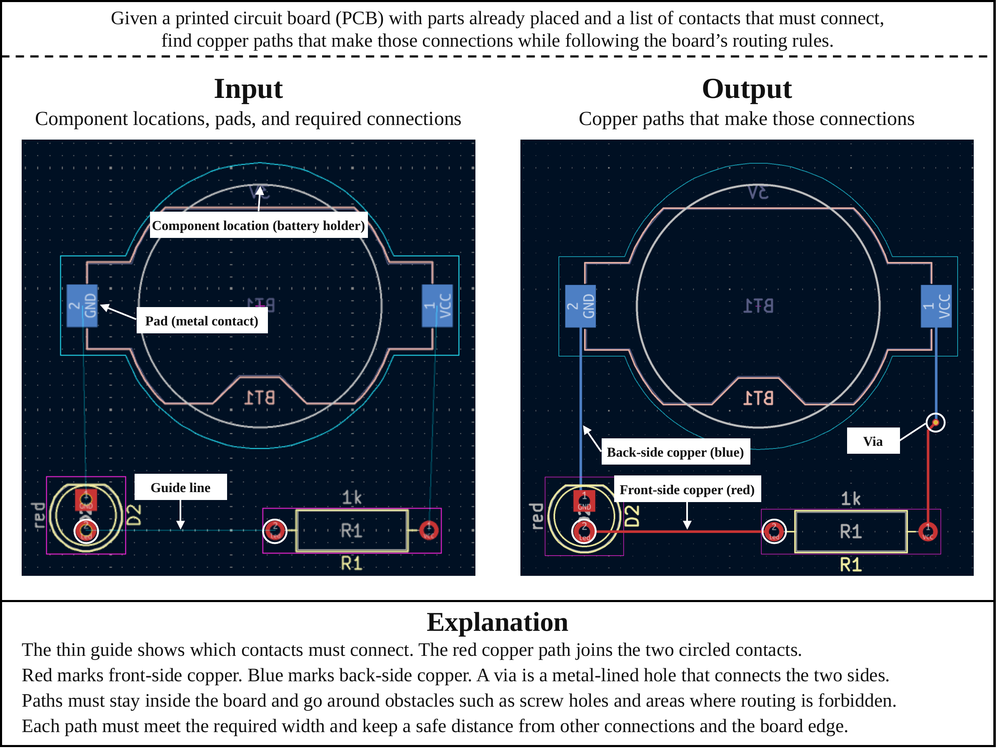
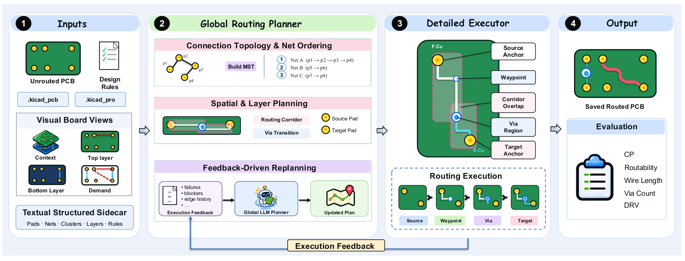

# PCBRouteAgent：LLM agent 距离 PCB 布线工程师还有多远？

<div class="research-tldr"><span class="eyebrow">TL;DR / 核心发现</span><p>PCB 布线需要同时考虑整板策略和精确的几何执行。PCBRouteAgent 将两者连接起来：生成布线引导、交给 KiCad 执行，并在局部恢复失败时修订引导。在 247 块板的评估中，四个 PCBWorld-Bench 测试集的整板通过率分别为 <strong>100%、94.9%、100% 和 40%</strong>。使用相同 Haiku 模型时，我们在四个测试集上均优于 PCBWorld 交互式 agent。</p></div>

## 给 PCB 布线，究竟要完成什么？

印刷电路板（PCB）通过铜线连接电子元件。元件布局确定后，布线需要把电路中指定的电气连接转化为板上不同铜层中的物理路径。除了连接相应的焊盘，还必须满足间距、线宽和允许换层位置等设计约束。

在我们的任务中，输入是已经固定元件布局、网表和设计规则，并移除目标布线的 KiCad 电路板；输出是相同原生格式的已布线电路板。最终由 PCBWorld 官方评估器判定：所有必需连接均已完成，并且 KiCad 检查不到错误级设计规则违规，整块板才算通过。画出一条看起来合理的线，还不等于成功。

<figure class="article-figure"><a class="figure-link" href="/assets/research/pcbrouteagent/task.png" aria-label="查看原图"></a><figcaption><span>PCB 布线通过铜线和过孔连接目标焊盘，并满足设计规则。</span><a href="/assets/research/pcbrouteagent/task.png">查看原图 ↗</a></figcaption></figure>

## 为什么要把规划和执行分开？

每一次布线都会改变后续连接的可行空间。一条很短的连接可能占据其他网络需要的通道；局部成功的路径，也可能让后续连接更难完成。因此，如果只根据当前状态决定下一次工具调用，而没有维护更完整的布线计划，就容易陷入反复尝试，增加交互成本。

我们的出发点是工程师在整板策略与局部操作之间的协调方式：先考虑需要连接哪些区域和目标，再用布线工具完成具体几何路径；执行暴露出障碍时，再调整策略。这启发我们让 agent 围绕布线引导进行推理，而不是让语言模型逐步控制每一个几何操作。

## 全局规划、局部布线，再根据反馈修订

PCBRouteAgent 包含三个功能组件，由执行控制器管理任务、检查点和有预算限制的恢复操作。

1. **Global Routing Planner（全局布线规划器）。** 结合结构化电路板信息与板图，指定未连通簇之间的连接、布线顺序、软通道和换层位置。初始引导由脚本构造；执行受阻后，再使用多模态模型修订引导。
2. **Detailed Routing Executor（详细布线执行器）。** 通过 KiCad 原生 push-and-shove 布线器落实引导，完成几何布线和有限的局部恢复，同时保留已接受的连接。
3. **Feedback-Driven Replanning（反馈驱动重规划）。** 局部恢复仍不能完成连接时，收集执行证据与未解决目标，由同一个全局规划器修订相关引导，再从一致的电路板状态继续执行。

这样分工的意义在于：模型不必细管每一步走线。原生引擎负责几何执行，模型则在需要整板视角时重新审视规划决策。

<figure class="article-figure"><a class="figure-link" href="/assets/research/pcbrouteagent/framework.png?v=3c60615" aria-label="查看原图"></a><figcaption><span>PCBRouteAgent 框架概览。</span><a href="/assets/research/pcbrouteagent/framework.png?v=3c60615">查看原图 ↗</a></figcaption></figure>

## 这个框架能完成更多电路板吗？

我们在 PCBWorld-Bench 的 **247 块板**上评估：128 块合成 D2 电路板、99 块小规模真实 D3-A 电路板、10 块中规模 D3-B 电路板，以及 10 块大规模 D3-C 电路板。下面的主要指标为 **Clean Pass（整板通过率）**：全部必需连接完成且没有错误级设计规则违规的电路板比例。

| 测试集 | 板数 | 最佳已评估基线 | 基线整板通过率 | PCBRouteAgent · Opus |
| :--- | ---: | :--- | ---: | ---: |
| D2 | 128 | Freerouting / KiCadRoutingTools / PPO w/o finish | 100% | **100%** |
| D3-A | 99 | PCBWorld PPO w/o finish | 81.0% | **94.9%** |
| D3-B | 10 | Freerouting | 64.0% | **100%** |
| D3-C | 10 | Freerouting | 30.0% | **40.0%** |

在三个真实电路板测试集上，Opus 版本分别比最佳已评估基线提高 **13.9、36 和 10 个百分点**；在 D2 上，与最强基线一样实现全部通过。

<details class="evaluation-note"><summary>评估细节：“基线”和 Reference 分别指什么？</summary><p>D2、D3-A 和 D3-B 的公开基线采用 <a href="https://arxiv.org/html/2607.05915v4#A12.T22">PCBWorld 表 22（@1）</a>的结果；Haiku 交互式基线及全部 D3-C 结果为本地评估。D3-B 的 PCBRouteAgent 结果包含未进入评分的模型响应失败重试和角度修复。“最佳已评估基线”不包括 Reference：后者评估公开数据集中保留的原始已布线设计，并不是重新运行自动布线器得到的结果。公开基线均值的聚合方式可能与我们每个实例提交一块板评分的方式不同。</p></details>

## 除了整板通过率，还有哪些变化？

整板通过率衡量一块板是否完整成功。为了看清布线质量，我们还比较 **Routability（必需连接的完成比例）**、平均 **DRV**、线长和过孔数。下面的互动图使用 Claude Opus 5.5 版本的 PCBRouteAgent，与 Freerouting、OrthoRoute 和 KiCadRoutingTools 三个规则式布线器对比。可以切换测试集和指标查看结果。Freerouting 是真实板测试集上整板通过率最高的已评估规则式基线。

<!-- ROUTING_COMPARISON -->

<p class="chart-source">数据来源：D2、D3-A、D3-B 的规则式基线采用 <a href="https://arxiv.org/html/2607.05915v4#A12.T22">PCBWorld 表 22（@1）</a>；D3-C 和 PCBRouteAgent 的结果为本地评估。</p>

<details class="routing-details"><summary>展开 Freerouting 详细对比表</summary>
<table>
<thead>
<tr>
<th style="text-align: left;">测试集</th>
<th style="text-align: left;">方法</th>
<th style="text-align: right;">Rout. ↑</th>
<th style="text-align: right;">DRV ↓</th>
<th style="text-align: right;">线长（mm）↓</th>
<th style="text-align: right;">过孔数 ↓</th>
</tr>
</thead>
<tbody>
<tr>
<td style="text-align: left;">D2</td>
<td style="text-align: left;">Freerouting</td>
<td style="text-align: right;"><strong>1.000</strong></td>
<td style="text-align: right;"><strong>0.00</strong></td>
<td style="text-align: right;">409.8</td>
<td style="text-align: right;">2.48</td>
</tr>
<tr>
<td style="text-align: left;">D2</td>
<td style="text-align: left;">PCBRouteAgent · Opus</td>
<td style="text-align: right;"><strong>1.000</strong></td>
<td style="text-align: right;"><strong>0.00</strong></td>
<td style="text-align: right;"><strong>392.5</strong></td>
<td style="text-align: right;"><strong>1.99</strong></td>
</tr>
<tr>
<td style="text-align: left;">D3-A</td>
<td style="text-align: left;">Freerouting</td>
<td style="text-align: right;">0.900</td>
<td style="text-align: right;">1.08</td>
<td style="text-align: right;"><strong>156.6</strong></td>
<td style="text-align: right;">0.86</td>
</tr>
<tr>
<td style="text-align: left;">D3-A</td>
<td style="text-align: left;">PCBRouteAgent · Opus</td>
<td style="text-align: right;"><strong>0.994</strong></td>
<td style="text-align: right;"><strong>0.09</strong></td>
<td style="text-align: right;">165.5</td>
<td style="text-align: right;"><strong>0.79</strong></td>
</tr>
<tr>
<td style="text-align: left;">D3-B</td>
<td style="text-align: left;">Freerouting</td>
<td style="text-align: right;">0.990</td>
<td style="text-align: right;">11.94</td>
<td style="text-align: right;"><strong>533.5</strong></td>
<td style="text-align: right;"><strong>3.88</strong></td>
</tr>
<tr>
<td style="text-align: left;">D3-B</td>
<td style="text-align: left;">PCBRouteAgent · Opus</td>
<td style="text-align: right;"><strong>1.000</strong></td>
<td style="text-align: right;"><strong>0.00</strong></td>
<td style="text-align: right;">591.6</td>
<td style="text-align: right;">4.00</td>
</tr>
<tr>
<td style="text-align: left;">D3-C</td>
<td style="text-align: left;">Freerouting</td>
<td style="text-align: right;">0.918</td>
<td style="text-align: right;">32.00</td>
<td style="text-align: right;"><strong>1304.0</strong></td>
<td style="text-align: right;">21.40</td>
</tr>
<tr>
<td style="text-align: left;">D3-C</td>
<td style="text-align: left;">PCBRouteAgent · Opus</td>
<td style="text-align: right;"><strong>0.949</strong></td>
<td style="text-align: right;"><strong>6.30</strong></td>
<td style="text-align: right;">1410.5</td>
<td style="text-align: right;"><strong>21.30</strong></td>
</tr>
</tbody>
</table>
</details>

在 **D3-A** 上，Routability 从 0.900 提高到 0.994，平均 DRV 从 1.08 降至 0.09。在 **D3-B** 上，PCBRouteAgent 在全部十块板上完成连接，且 DRV 为零。整板通过率的提高，伴随着连通性的提升和违规计数的下降。

在 **D3-C** 上，平均 Routability 从 0.918 提高到 0.949，DRV 从 32.00 降到 6.30，**下降 80.3%**；但十块板中仍然只有四块通过。这说明整板成功是严格的指标：即使只剩少数未解决连接，一块已经接近完成的板也可能无法通过。

物理布线成本存在取舍。相比 Freerouting，Opus 版本在 **D3-B 上线长增加 10.9%**，在 **D3-C 上增加 8.2%**，同时完成了更多电路板。单独看较短的线长并不能判断布线更好，因为未完成的方案也可能只是铺设了更少的铜线。需要把完成度、规则合规性和物理成本放在一起判断。

## 提升是不是只来自更强的模型？

我们进一步让 PCBRouteAgent 和 PCBWorld 交互式 agent 使用**相同的 Claude Haiku 5.5 backbone**，在固定模型的情况下比较整体 agent 框架。

<div class="comparison-key"><span><i class="baseline-key"></i>PCBWorld · Haiku</span><span><i class="ours-key"></i>PCBRouteAgent · Haiku</span><span>整板通过率 · 越高越好</span></div>
<div class="comparison-chart" role="img" aria-label="Haiku 整板通过率对比：D2 从 63.3% 提升到 100%；D3-A 从 34.3% 提升到 92.9%；D3-B 从 0% 提升到 80%；D3-C 从 0% 提升到 10%。">
<div class="comparison-row"><strong>D2</strong><div class="bar-pair"><div class="result-bar baseline-bar" style="--value:63.3%"><span>63.3%</span></div><div class="result-bar ours-bar" style="--value:100%"><span>100%</span></div></div><b>+36.7 pp</b></div>
<div class="comparison-row"><strong>D3-A</strong><div class="bar-pair"><div class="result-bar baseline-bar" style="--value:34.3%"><span>34.3%</span></div><div class="result-bar ours-bar" style="--value:92.9%"><span>92.9%</span></div></div><b>+58.6 pp</b></div>
<div class="comparison-row"><strong>D3-B</strong><div class="bar-pair"><div class="result-bar baseline-bar" style="--value:0%"><span>0%</span></div><div class="result-bar ours-bar" style="--value:80%"><span>80%</span></div></div><b>+80 pp</b></div>
<div class="comparison-row"><strong>D3-C</strong><div class="bar-pair"><div class="result-bar baseline-bar" style="--value:0%"><span>0%</span></div><div class="result-bar ours-bar" style="--value:10%"><span>10%</span></div></div><b>+10 pp</b></div>
</div>

四个测试集上的提升说明，整体规划与执行框架确实有效，收益不只来自模型选择。不过，这组对比没有单独隔离每个组件的贡献，也没有控制为相同的交互预算。图中的 pp 表示百分点。

我们没有完整评估 PCBWorld–Opus，因为已经验证，其逐步调用模型的方式会产生显著高于 PCBRouteAgent 的 API 费用。相同 Haiku backbone 的对比提供了直接证据，无需依赖未测量的 Opus 基线成绩。

## 完成布线，需要多少计算资源？

下面的比较让两个框架都使用 **Claude Haiku 5.5，并采用相同的本地评估条件和计时范围**。数值为每板均值，包含未通过的电路板；输入和输出 token 的单位为千（k），费用来自记录的 API 消耗。

| 测试集 | 方法 | 耗时（s） | 模型调用 | 输入（k） | 输出（k） | 费用（$） |
| :--- | :--- | ---: | ---: | ---: | ---: | ---: |
| D2 | PCBWorld | 188.0 | 43.20 | 45.8 | 38.9 | 0.0240 |
| D2 | PCBRouteAgent | **0.8** | **0.05** | **1.6** | **0.1** | **0.0002** |
| D3-A | PCBWorld | 436.0 | 76.60 | 112.6 | 88.1 | 0.0553 |
| D3-A | PCBRouteAgent | **27.0** | **0.87** | **19.9** | **5.8** | **0.0048** |
| D3-B | PCBWorld | 1817.0 | 263.90 | 900.0 | 352.0 | 0.2660 |
| D3-B | PCBRouteAgent | **146.0** | **2.90** | **163.0** | **30.0** | **0.0330** |
| D3-C | PCBWorld | 4566.0 | 676.60 | 5430.0 | 816.0 | 0.9510 |
| D3-C | PCBRouteAgent | **516.0** | **5.10** | **666.0** | **62.0** | **0.3930** |

在每个测试集上，PCBRouteAgent 的模型调用、token、耗时和 API 费用都更低。D2 上的平均模型调用从 **43.20 次降到 0.05 次**；D3-C 上从 **676.60 次降到 5.10 次**。每板均值可以小于一次调用，是因为许多电路板只靠脚本初始化引导和原生布线执行就能完成，不需要调用模型修订引导。

### 全部 247 块板的累计消耗

| 方法 | 模型调用 | 输入 token | 输出 token | API 费用 | 累计耗时 |
| :--- | ---: | ---: | ---: | ---: | ---: |
| PCBWorld · Haiku | 22,529 | 80.3M | 25.4M | $20.72 | 36.4 h |
| PCBRouteAgent · Haiku | **172** | **10.5M** | **1.5M** | **$4.77** | **2.6 h** |

整个测试集上，模型调用约减少到原来的 **1/131**，总 token 减少到 **1/8.8**，API 费用减少到 **1/4.3**，累计运行时间减少到 **1/14**。累计耗时是各块板运行时间之和，不代表并行批处理的实际持续时间。这些资源消耗的下降，伴随着四个测试集上更高的整板通过率。

### 相对于实际完成量的成本

按每条接通的目标边归一化后，token 消耗仍然明显下降：D2 从 **11,374 降到 202**，D3-A 从 **22,079 降到 1,972**，D3-B 从 **65,545 降到 4,355**，D3-C 从 **269,324 降到 6,744**。该指标用每个测试集的全部输入和输出 token，除以实际接通的目标边总数。

较低的每板费用不等于较低的每块成功板成本。在 D3-C 上，PCBRouteAgent 每板花费 $0.393，但 Haiku 版本十块板中只有一块通过；用总费用除以通过板数，得到的**每块通过板成本为 $3.93**。PCBWorld–Haiku 在 D3-B 和 D3-C 上没有通过板，因此对应指标没有定义。提高大板上的可靠完成率，对布线质量和实际效率都很重要。

## 距离布线工程师，还有哪些差距？

仍有明显差距。在最大规模测试集上，Opus 版本只通过了 10 块板中的 4 块。平均 Routability 虽然达到 0.949，但较高的平均连通率不意味着整板所有连接都已完成且满足规则。布线紧凑性也有改进空间：在 D3-C 上，相比 Freerouting，整板通过率从 30% 提高到 40%，但线长也增加了 8.2%。

这些结果支持一种分工：由原生布线器处理物理执行，模型则依据执行证据修订整板规划。接下来需要解决的，是大规模电路板上的完整布线、更紧凑的路径，以及对各组件贡献的受控消融研究。

## Citation

本文已提交 arXiv，正在等待公布。可以使用以下 BibTeX；正式公开后将补充论文链接和编号。

```bibtex
@unpublished{zhang2026pcbrouteagent,
  title  = {{PCBRouteAgent}: How Close Are {LLM} Agents to Becoming {PCB} Routing Engineers?},
  author = {Zhang, Yue and Sun, Jilei and Jing, Liqiang and Wei, Yijie and Yang, Ruohan},
  year   = {2026},
  note   = {Submitted to arXiv; awaiting announcement}
}
```

[下载 BibTeX](/assets/research/pcbrouteagent/pcbrouteagent.bib)

## 相关资源

- [PCBRouteAgent 项目代码](https://github.com/chip-ai-agent/PCBRouteAgent)
- [PCBWorld: A Benchmark Environment for Engine-Grounded PCB Design Automation](https://arxiv.org/abs/2607.05915)
- [KiCad 官方文档](https://docs.kicad.org/)
